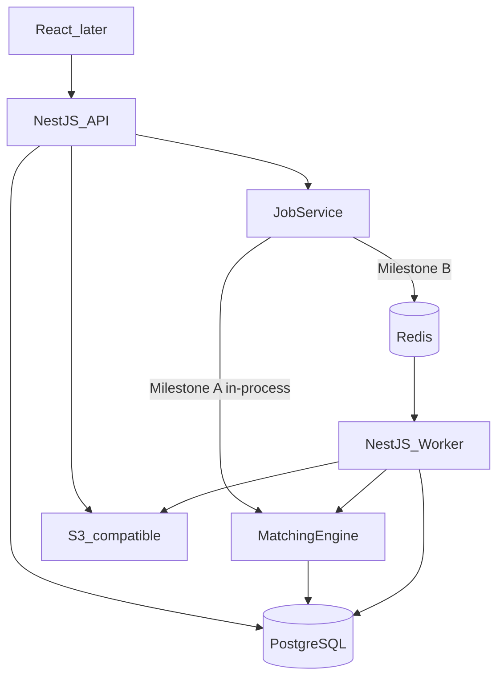

# ReconcileX Implementation Plan (Backend-First)

This plan treats [C:\Users\Pushkar Raj\Desktop\reconcile-x\ReconcileX_PRD.md](C:\Users\Pushkar Raj\Desktop\reconcile-x\ReconcileX_PRD.md) as the source of truth. The repo today contains only the PRD and git history. **Implementation will start in that folder after plan approval**, via `move_agent_to_root` before any files are created.

**Execution constraint from you:** implement and stabilize the **backend API + domain + database** through Milestone A before building the React app. Frontend is fully designed here so it does not force backend redesign later, but it is not part of the first implementation wave.

---

## 1. Executive Summary

ReconcileX is a multi-tenant reconciliation platform: CSV in, normalize, match two sources with explainable rules, surface exceptions, audit everything. Complexity is in correctness, isolation, idempotency, and jobs—not in screen count.

**Milestone A (this wave):** working HTTP APIs so an analyst can register an org, configure sources, import CSVs, run pairwise reconciliation, inspect matches/exceptions, resolve them, and read dashboard + audit data. Matching and import run **in-process but behind a JobService interface** so Milestone B can swap in BullMQ without rewriting the engine.

**Milestone B:** Redis/BullMQ workers, progress, retries/DLQ, reports/exports, notifications, benchmarks, CI/CD, OpenTelemetry.

**Non-goals (locked):** no microservices, Kubernetes, AI matching, real payments, card data, or mobile.

---

## 2. PRD Analysis and Technical Observations

**What the PRD actually requires**

- Pairwise comparison of independent sources (orders vs gateway vs bank), not a general ledger.
- Deterministic, explainable matching with confidence and reason codes.
- CSV-only ingestion for MVP; files are untrusted.
- Organization isolation on every query; RBAC on the server.
- Immutable audit log.
- Async processing is a **reliability** requirement for large files, not a day-one runtime requirement.
- Money is domain-sensitive: never use IEEE floats.

**Gaps the PRD leaves open (recommendations below, marked as decisions)**

- ORM, auth token style, money storage, 2-way vs N-way matching, duplicate policy, exception auto-creation, job table vs queue as source of truth, local S3, invitation vs open signup.

**Sequencing improvement vs PRD roadmap**

PRD puts “full schema then features,” then matching, then exceptions, then workers, then security/tests at the end. Better:

1. Platform + tenancy **before** any resource APIs.
2. Pure matching engine **before** run orchestration.
3. Sync JobService + DB transactions + unique constraints **before** retryable workers (so retries cannot double-write).
4. Security controls in every phase; a later phase is a **review**, not the first time authz exists.
5. Tests in the same phase as the code they protect.
6. Frontend **after** backend MVP contracts exist (your instruction).

---

## 3. Recommended Architecture




**Modular monolith:** one NestJS codebase, two entrypoints (`apps/api`, `apps/worker`). Domain lives in Nest modules; worker imports the same services. No separate matching microservice.

**Tenant isolation pattern:** every table that holds org data has `organization_id`. Repositories always take `orgId` from the authenticated membership, never from an unchecked body field. Resource IDs are UUIDs; listing/getting always `AND organization_id = $org`.

**Job abstraction:** `JobService.enqueue(type, payload, { idempotencyKey })` writes a `jobs` row. MVP executor runs inline (or `setImmediate`) after commit. Milestone B publishes to BullMQ with the same `jobs.id`.

---

## 4. Technology Decisions and Justifications


| Decision       | Choice                                                                                                  | Why                                                                                  | Trade-off                                       |
| -------------- | ------------------------------------------------------------------------------------------------------- | ------------------------------------------------------------------------------------ | ----------------------------------------------- |
| Backend        | NestJS + TypeScript strict                                                                              | PRD recommendation; modules, guards, DI match RBAC/workers                           | More boilerplate than Express                   |
| ORM            | **Drizzle ORM** (recommendation)                                                                        | SQL-first bulk inserts, unique indexes, matching queries, incremental SQL migrations | Less Nest “magic” than TypeORM/Prisma           |
| DB             | PostgreSQL 16                                                                                           | Relational constraints, transactions, reporting                                      | Must design indexes from query patterns         |
| Auth           | Argon2id passwords; **JWT access (15m) + refresh (7d) in httpOnly Secure cookies**                      | CSRF via SameSite; no tokens in localStorage                                         | Frontend must use `credentials: include`        |
| Money          | `BIGINT` **minor units** (paise/cents) + `CHAR(3)` currency                                             | Exact equality for matching                                                          | Display layer converts                          |
| Matching scope | **Exactly two data sources per run**                                                                    | Matches PRD examples; 3-way later                                                    | No automatic order-gateway-bank triangle in MVP |
| Duplicates     | Flag + quarantine, **do not auto-delete**                                                               | PRD: legitimate repeats must survive                                                 | Analyst must confirm                            |
| Exceptions     | Auto-open for **unmatched** after a run; potential matches are not exceptions until rejected/unresolved | Clear workflow                                                                       | Volume of OPEN exceptions on bad data           |
| Object storage | S3 API; **MinIO in Docker Compose** locally                                                             | Matches production shape                                                             | Extra compose service                           |
| Queue (B only) | Redis + BullMQ                                                                                          | PRD; retries, backoff, DLQ                                                           | Not in Milestone A runtime                      |
| Monorepo       | **pnpm workspaces**                                                                                     | Shared types between api/worker/web                                                  | Tooling setup once                              |
| Tests          | Vitest (unit/integration), Testcontainers or Compose Postgres for API tests                             | Fast unit tests; real SQL for matching/import                                        | E2E UI tests wait for frontend wave             |
| API docs       | OpenAPI via Nest Swagger, generated from DTOs                                                           | Contract for later UI                                                                | Keep DTOs as source of truth                    |


**Confirmed PRD, not recommendations:** React+TS+Tailwind later, PostgreSQL, Redis/BullMQ later, S3, Docker, GitHub Actions, OpenTelemetry, modular monolith, no K8s/microservices/AI matching.

---

## 5. Proposed Monorepo Structure

```text
reconcile-x/
  apps/
    api/                 NestJS HTTP (main.ts)
    worker/              NestJS worker (main.ts) — stub until Milestone B
    web/                 React+Vite — scaffolded late, implemented after backend MVP
  packages/
    db/                  Drizzle schema, migrations, seed
    shared/              Enums, match reason codes, API DTO types
    matching/            Pure matching + scoring (no Nest, no IO)
    csv/                 Parse, validate, normalize (no Nest, no IO)
  infra/
    docker/              compose: postgres, redis, minio
    github/workflows/    added in CI phase
  docs/
    adr/                 ADRs
    architecture.md
  scripts/               sample CSV generators (synthetic only)
  package.json           pnpm workspace root
```

**Responsibility:** `packages/matching` and `packages/csv` are independently unit-tested. `apps/api` wires auth, persistence, jobs. `packages/db` owns schema. Do not put matching SQL inside controllers.

---

## 6. Database Implementation Roadmap

**Global rules:** UUID PKs; `created_at`/`updated_at`; `organization_id` on tenant tables; FKs; no float money; audit_logs have **no update/delete** from app repositories.

### Entities (full vision)

**organizations** — Tenant. Fields: `id`, `name`, `slug` unique, `status`. Isolation root.

**users** — Login identity. Fields: `id`, `email` unique, `password_hash`, `name`, `status`. Users may belong to multiple orgs via memberships (keep model ready; MVP UI can assume one org).

**organization_memberships** — `user_id`, `organization_id`, `role` enum (`ADMIN|FINANCE_MANAGER|ANALYST|AUDITOR`), unique `(user_id, organization_id)`.

**invitations** — email, org, role, token hash, expires_at.

**data_sources** — org-scoped. `name`, `type` (`INTERNAL_ORDERS|PAYMENT_GATEWAY|BANK|OTHER`), `direction` unused in MVP, `column_mapping` JSON (CSV headers → canonical fields), unique `(organization_id, name)`.

**imports** — upload+parse job. `data_source_id`, `storage_key`, `original_filename`, `content_sha256`, `status`, `row_count`, `valid_count`, `invalid_count`, `duplicate_count`, `error_summary` JSON. Unique `(organization_id, data_source_id, content_sha256)` for idempotent re-upload.

**import_row_errors** — row_number, code, raw_value, message.

**transactions** — canonical record. `data_source_id`, `import_id`, `external_id`, `amount_minor`, `currency`, `transaction_date` (date), `reference`, `external_txn_id`, `merchant_or_order_id`, `txn_type`, `status`, `normalized_payload` JSON, `fingerprint`. Unique `**(organization_id, data_source_id, external_id)`**. Indexes: `(organization_id, transaction_date)`, `(organization_id, status)`, `(organization_id, reference)`, `(organization_id, reconciliation-related status)`.

**duplicate_candidates** — pair of transaction ids or import-row vs existing, `reason`, `status` (`FLAGGED|DISMISSED|CONFIRMED_DUPLICATE`).

**reconciliation_runs** — `source_a_id`, `source_b_id`, `status`, `started_at`, `completed_at`, `config` JSON (date window, score thresholds), counters. Display id `RUN-YYYYMMDD-NNN` unique per org.

**matches** — `run_id`, `transaction_a_id`, `transaction_b_id`, `classification` (`EXACT|POTENTIAL`), `score`, `reasons` JSONB. Unique `(run_id, transaction_a_id, transaction_b_id)`. Partial unique: a transaction may match at most one counterpart **per run**.

**exceptions** — `run_id`, `transaction_id` (nullable if pair-level), `status` (`OPEN|ASSIGNED|UNDER_REVIEW|ESCALATED|RESOLVED`), `assignee_id`, `resolution_reason`, `resolution_action`, `resolved_by`, `resolved_at`. Unique open exception per `(run_id, transaction_id)`.

**exception_comments** — exception_id, author_id, body.

**audit_logs** — `organization_id`, `actor_user_id` (nullable for system), `action`, `entity_type`, `entity_id`, `previous_state` JSONB, `new_state` JSONB, `request_id`, `created_at`. **Append-only.** Index `(organization_id, created_at desc)`, `(entity_type, entity_id)`.

**notifications** — Milestone B. `user_id`, `org_id`, `type`, `payload`, `read_at`.

**jobs** — `type`, `status` (`QUEUED|PROCESSING|COMPLETED|FAILED|DEAD_LETTER`), `payload`, `idempotency_key` unique, `progress_current`, `progress_total`, `attempts`, `last_error`, `result`. Index `(organization_id, created_at)`.

### Schema by phase


| Phase | Migrations                                                                |
| ----- | ------------------------------------------------------------------------- |
| A1    | none beyond health; compose Postgres up                                   |
| A2    | organizations, users, memberships, invitations, refresh_tokens            |
| A3    | data_sources, transactions (empty ingest)                                 |
| A4    | imports, import_row_errors, duplicate_candidates; transaction insert path |
| A5    | none (pure package)                                                       |
| A6    | reconciliation_runs, matches; transaction status updates                  |
| A7    | exceptions, exception_comments                                            |
| A8    | audit_logs (if not introduced incrementally from A2), jobs                |
| B1    | job columns for progress/DLQ if needed; notifications later               |


Do **not** create matches/exceptions in A1–A2.

---

## 7. API Implementation Roadmap

Base: `/api/v1`. Auth: cookie session. Org context: `X-Organization-Id` **or** membership if user has one org (must still be verified). All org routes: 401 if anonymous, 403 if wrong org/role, 404 if id exists in another org (same as missing—prevents IDOR probing).

### Auth

- `POST /auth/register` — create user + org + ADMIN membership. Public. Body: name, email, password, orgName.
- `POST /auth/login` — rate-limited. Sets cookies.
- `POST /auth/logout` — revoke refresh.
- `POST /auth/refresh` — rotate refresh.
- `POST /auth/password-reset/request` — always 202.
- `POST /auth/password-reset/confirm`
- `GET /auth/me`

### Organizations / users

- `GET /organizations` — memberships.
- `PATCH /organizations/:orgId` — ADMIN. settings.
- `GET /organizations/:orgId/members` — ADMIN.
- `POST /organizations/:orgId/invitations` — ADMIN.
- `POST /invitations/accept`
- `PATCH /organizations/:orgId/members/:userId` — role change, ADMIN.
- `DELETE /organizations/:orgId/members/:userId` — ADMIN, not last admin.

### Data sources

- `GET/POST /orgs/:orgId/data-sources` — GET all authenticated; POST ADMIN or FINANCE_MANAGER.
- `GET/PATCH/DELETE /orgs/:orgId/data-sources/:id` — DELETE soft; config mapping on PATCH.

### Imports

- `POST /orgs/:orgId/data-sources/:id/imports` — multipart CSV; ANALYST+. Idempotency-Key optional. Returns `{ jobId, importId, status }`.
- `GET /orgs/:orgId/imports` — paginated.
- `GET /orgs/:orgId/imports/:id` — status, counts, errors page.
- `GET /orgs/:orgId/imports/:id/errors` — paginated row errors.

### Transactions

- `GET /orgs/:orgId/transactions` — filters: source, date from/to, amount, status, runId, matchType, q (external_id or reference exact/prefix). Sort + cursor/limit pagination.
- `GET /orgs/:orgId/transactions/:id`
- `GET /orgs/:orgId/duplicate-candidates`

### Reconciliation

- `POST /orgs/:orgId/reconciliation-runs` — body sourceA, sourceB, date range, config. ANALYST+. Returns job + run.
- `GET /orgs/:orgId/reconciliation-runs`
- `GET /orgs/:orgId/reconciliation-runs/:id` — counters, status.
- `GET /orgs/:orgId/reconciliation-runs/:id/matches` — exact | potential.
- `GET /orgs/:orgId/reconciliation-runs/:id/unmatched`
- `POST /orgs/:orgId/matches/:id/confirm` — promote potential to matched (manager/analyst).
- `POST /orgs/:orgId/matches/:id/reject` — unmatched + exception.

### Exceptions

- `GET /orgs/:orgId/exceptions` — filters status, assignee, run.
- `GET /orgs/:orgId/exceptions/:id`
- `POST /orgs/:orgId/exceptions/:id/assign`
- `POST /orgs/:orgId/exceptions/:id/comments`
- `POST /orgs/:orgId/exceptions/:id/status` — UNDER_REVIEW, ESCALATE, RESOLVE (reason required), REOPEN.
- Auditor: GET only.

### Audit / dashboard / jobs

- `GET /orgs/:orgId/audit-logs` — ADMIN, MANAGER, AUDITOR; ANALYST limited to entities they touched (or imports/exceptions they created)—enforce in query.
- `GET /orgs/:orgId/dashboard` — aggregates for latest or selected run + org totals.
- `GET /orgs/:orgId/jobs/:id` — progress.

### Health

- `GET /health` `GET /health/ready` (DB ping; Redis later).

Error envelope: `{ error: { code, message, details? } }` — no stacks.

---

## 8. Frontend Implementation Roadmap (Deferred)

Do not implement in the first wave. Contracts above are the UI dependency list.

**Pages → APIs:** login/register → auth; onboarding if no org → register already created org; dashboard → dashboard; data sources → CRUD; CSV wizard (map columns, upload, poll job/import) → imports; import history → imports; runs list/detail → reconciliation; explorer → transactions; potential matches → matches confirm/reject; exceptions list/detail → exceptions; audit; users; org settings.

**Shared UI (when built):** AppShell, OrgSwitcher, RoleGate (UX only), DataTable+filters+pagination, FileDropzone, JobProgress, MatchReasonList, ExceptionTimeline, Empty/Error/Loading.

**Rule:** UI never is the authorization layer.

---

## 9. Detailed Phase-by-Phase Implementation Plan

### Phase A0 — Design lock (docs only, short)

**Objective:** Write ADRs so later phases do not reopen ORM/auth/money/matching-scope.

**Tasks:** ADRs for Drizzle, cookie JWT, minor units, two-source runs, JobService, duplicate flagging.

**DoD:** `docs/adr/*.md` exist. No application code required if you prefer to fold this into A1.

**Depends on:** nothing.

---

### Phase A1 — Backend foundation

**Why:** Repeatable env before domain code.

**Implement:** pnpm workspace; `apps/api` NestJS; strict TS; ESLint/Prettier; Docker Compose (Postgres 16, later Redis/MinIO); `.env.example`; config module; global exception filter; request-id middleware; pino structured logs (no secrets); `GET /health` + `/health/ready`; Swagger skeleton; Vitest.

**DB:** Compose only.

**Files:** `apps/api/src/main.ts`, `common/http`, `infra/docker/docker-compose.yml`, `packages/db` empty drizzle config.

**Tests:** health ready fails if DB down; boots with compose.

**DoD:** `docker compose up` + `pnpm --filter api start` + health 200. No domain modules.

**Frontend:** none.

---

### Phase A2 — Identity, organizations, RBAC

**Why:** No tenant APIs without this.

**Backend:** register/login/logout/refresh/me; Argon2id; memberships; role enum; `AuthGuard` + `OrgGuard` + `RolesGuard`; invitations; password reset tokens hashed; last-admin protection.

**DB:** users, organizations, memberships, invitations, refresh_tokens.

**APIs:** auth + org member endpoints.

**Tests:** integration: wrong password 401; login rate-limit stub (full Redis limit in B); user in org A cannot GET org B members (404/403); analyst cannot PATCH org; invite accept.

**DoD:** cookie auth works via HTTP tests; every subsequent module uses guards.

**Security in this phase:** password hashing, reset token hashing, cookie flags, org scoping on member routes.

---

### Phase A3 — Data sources and transaction catalog

**Why:** Matching needs stable source and transaction identities before CSV.

**Backend:** data source CRUD + column mapping JSON schema (canonical fields: external_id, amount, date, currency, reference, …). Transaction **read** APIs against empty table. Soft delete sources blocked if transactions exist (or deactivate).

**DB:** data_sources, transactions (table created, no import writer yet).

**Tests:** unique name per org; org isolation on GET by id.

**DoD:** can create two sources per org; OpenAPI updated.

---

### Phase A4 — CSV ingestion (sync JobService)

**Why:** Independent, testable pipeline; feeds matching.

**packages/csv:** stream parse (do not load entire file into memory); validate required fields; normalize amount/date/currency; collect row errors; fingerprint rows.

**apps/api:** upload to MinIO; size/extension/MIME/row-count limits; create import; JobService runs parse→normalize→duplicate detect→insert in a DB transaction **per batch** (e.g. 1000 rows); unique violation on `(org, source, external_id)` → duplicate candidate, not crash; import fingerprint short-circuits identical file.

**DB:** imports, import_row_errors, duplicate_candidates.

**APIs:** import POST/GET, errors, job status.

**Tests:** invalid amount row 1832 style; date formats; `₹1,000.00` → 100000 paise INR; duplicate file returns same import; org B cannot read org A import; file over max size 413; non-CSV rejected.

**DoD:** valid CSV produces transactions; invalid rows reported; duplicates flagged not deleted; HTTP returns before thinking it must wait forever—but MVP may still process inline for small files (document max rows for sync, e.g. 20k).

---

### Phase A5 — Deterministic matching engine (pure)

**Why:** Must be correct before runs/jobs.

**packages/matching:** functions `scorePair`, `classify`, `matchTwoSets`.

**Rules (MVP, documented in config defaults):**

1. Same currency required or no match.
2. Exact `reference` (normalized) + exact `amount_minor` → EXACT, score 100, reasons `[REFERENCE, AMOUNT]`.
3. Else score: amount 30, date within ±N days 20 (taper), reference equality 50 or normalized similarity **only as exact/contains—not fuzzy ML**, external_id/order id  optional +20. Thresholds: ≥100 EXACT (cap 100), ≥80 POTENTIAL_STRONG, ≥60 POTENTIAL, else none.
4. Greedy: highest score first; each txn at most one match in a run.
5. Reason payload for UI: which fields matched, date delta.

**Tests:** PRD examples (ORD-1001 / TXN-7832 / bank); date +1 day potential; different currency unmatched; greedy does not double-match.

**DoD:** package tests green; **no HTTP**.

---

### Phase A6 — Reconciliation runs and results

**Why:** Product loop: two sources → run → matched / potential / unmatched.

**Backend:** create run; snapshot config; load candidate txns by date window; call matching package; persist matches; set transaction statuses (`MATCHED|POTENTIAL_MATCH|UNMATCHED`); counters; idempotency key on create.

**APIs:** runs CRUD-read, matches, unmatched, confirm/reject potential.

**Tests:** integration with seeded two CSVs; confirm promotes; reject unmatches; cannot run two PROCESSING on same pair without idempotency; isolation.

**DoD:** GET run shows PRD-like counters. Engine still in-process.

---

### Phase A7 — Exceptions

**Why:** Human workflow on unmatched.

**Backend:** after run, create OPEN exceptions for unmatched (one per txn). Assign, comment, UNDER_REVIEW, ESCALATE, RESOLVE (reason+action required), REOPEN. Status machine enforced server-side. Auditor cannot POST.

**DB:** exceptions, comments.

**Tests:** illegal transitions 409; resolve without reason 422; assignee isolation; reopen from RESOLVED.

**DoD:** exception lifecycle complete via API.

---

### Phase A8 — Audit, dashboard, jobs read model — **Backend MVP**

**Why:** PRD MVP items 14–15 and reliability visibility.

**Backend:** audit writer used by A2–A7 (backfill hooks: login optional, import, run start/complete, exception resolve, role change). Append-only repository. Dashboard aggregates (SQL, not cache). Jobs already written in A4/A6—expose GET.

**Tests:** resolving exception inserts audit with previous/new state; analyst limited audit query; dashboard numbers match run counters; cannot PATCH audit.

**DoD:** Milestone A completion criteria (section 10) all pass via API/HTTP tests.

---

### Frontend wave (after you say to start frontend)

**F1** Vite React TS Tailwind, auth pages, org shell, role-aware nav.

**F2** Data sources, CSV map/upload, import history, job polling.

**F3** Runs, results, explorer, potential matches, exceptions, dashboard, audit.

Each F phase uses existing APIs only.

---

### Milestone B phases (after UI or after backend MVP—workers do not need UI)

**B1** Redis, BullMQ, `apps/worker`, move import+reconcile off HTTP, progress, retries with backoff, DLQ, idempotent job start (`UPDATE jobs SET status=PROCESSING WHERE id AND status=QUEUED`), crash resume.

**B2** Reports CSV (PDF after reports stable), in-app notifications + email stub.

**B3** Rate limiting (Redis), security review, benchmarks 10k/100k/1M, indexes from EXPLAIN, streaming only.

**B4** Prod compose/Caddy or nginx HTTPS docs, GitHub Actions, OpenTelemetry traces/metrics, README/architecture/portfolio numbers.

---

## 10. MVP Completion Criteria (Milestone A)

API-level (frontend not required):

1. Register creates org + admin.
2. Login/logout cookies.
3. Invite/change roles; auditor cannot import.
4. Configure ≥2 data sources with mappings.
5. Upload CSV; validation errors per row.
6. Normalized amounts/dates stored.
7. Duplicates flagged.
8. Transactions persisted and listable with pagination.
9. Start reconciliation of two sources.
10. Deterministic matches with reasons.
11. View matched, potential, unmatched.
12. Exceptions auto-created for unmatched; assign/comment.
13. Resolve with reason; reopen.
14. Dashboard counters consistent with run.
15. Audit history for resolve/import/run.

MVP explicitly **does not** require BullMQ, email, PDF, WebSockets, or the React app.

---

## 11. Advanced Version Roadmap

BullMQ workers; job progress (WebSocket optional—polling is enough first); strong idempotency; richer exception SLA; CSV/PDF reports; notifications; configurable scoring UI; performance evidence; CI/CD; OTel; security review; then PRD “Phase 13” extras (webhooks, scheduled imports, fuzzy search)—only if core is stable.

---

## 12. Testing Strategy

- **Unit:** `packages/csv`, `packages/matching`, exception state machine, scoring.
- **Integration:** Nest + real Postgres; tenant isolation matrix; import uniqueness; run idempotency.
- **Worker (B1):** crash mid-job, duplicate enqueue, retry then DLQ.
- **Failure:** invalid CSV, unauthorized, cross-org IDOR, DB down → 503 on ready.
- **E2E UI:** after F3 (Playwright).
- Meaningful coverage on matching/import/authz, not vanity %.

---

## 13. Security Strategy

**From A1–A2:** hashed passwords, cookie flags, DTO validation (class-validator or Zod), error sanitization, org in every query.

**Every resource phase:** IDOR tests; RBAC table from PRD §7 encoded as `@Roles`.

**Uploads:** size, extension, content-type, parse errors, no path-controlled storage keys (server-generated).

**A8+:** audit of security-sensitive actions.

**B3:** rate limits (login 5/min, API 100/min configurable), helmet, CORS allowlist, secret scanning, HTTPS, no real PII in fixtures.

---

## 14. Performance and Scalability Strategy

- Stream CSV; batch inserts; never `SELECT *` without limit.
- Matching: SQL prefilter (same amount or same reference) then in-memory score for candidates, not N×M in JS for 1M×1M.
- Measure before indexes beyond the PRD starters.
- Cache dashboard only after B3 proves slow.
- Scale path: more worker processes sharing Redis; Postgres pooling; later read replicas—not now.

---

## 15. Deployment and CI/CD Strategy

Local: Compose for all deps. CI (B4): lint, typecheck, unit, integration (service containers), docker build. Deploy: single VM or any Docker host running api+worker+postgres+redis+minio. No Kubernetes.

---

## 16. Risks and Dependencies


| Risk                  | When     | Impact                 | Mitigation                                                                        | Test                   |
| --------------------- | -------- | ---------------------- | --------------------------------------------------------------------------------- | ---------------------- |
| Wrong matches         | A5–A6    | Bad financial ops      | Pure engine + fixtures from PRD                                                   | Golden-file unit tests |
| Duplicate imports     | A4, B1   | Double money           | sha256 unique + job idempotency key                                               | Re-POST same file      |
| Cross-org leak        | all APIs | Critical               | orgId from membership; 404                                                        | IDOR suite             |
| Worker crash          | B1       | Partial matches        | Single transaction per batch; job status CAS; run not COMPLETED until all batches | Kill worker            |
| Double job            | B1       | Duplicate matches      | unique idempotency; unique match pairs                                            | Two workers            |
| DB races on confirm   | A6       | Two potential confirms | row lock / unique match per txn per run                                           | concurrent PATCH       |
| Large CSV OOM         | A4       | API death              | stream + row cap + async in B1                                                    | 100k fixture           |
| Exception state drift | A7       | Stuck items            | explicit FSM                                                                      | transition table tests |
| Audit mutation        | A8       | Compliance             | no update repo; DB revoke UPDATE later                                            | attempt PATCH 404      |
| Slow explorer         | A3+      | Unusable UI            | pagination + indexes after EXPLAIN                                                | 100k seed              |


**Critical phase graph:** A1 → A2 → A3 → A4 → A5 → A6 → A7 → A8 → (F* and/or B1). A5 may overlap A4. B1 must not start before A6+A8 job/idempotency model exists.

---

## 17. Final Recommended Implementation Order

1. A1 Foundation
2. A2 Auth/tenancy/RBAC
3. A3 Data sources + transaction schema
4. A4 CSV pipeline + sync jobs
5. A5 Matching package
6. A6 Runs/results
7. A7 Exceptions
8. A8 Audit/dashboard → **Backend MVP**
9. Stop for your frontend wave (F1–F3)
10. B1 Workers
11. B2 Reports/notifications
12. B3 Security review + benchmarks
13. B4 CI/CD, OTel, docs

When you say **Implement Phase A1**, the work is exactly: monorepo, NestJS API, Docker Postgres, health, logging, errors, Vitest—**no React, no matching, no schema beyond connectivity**.