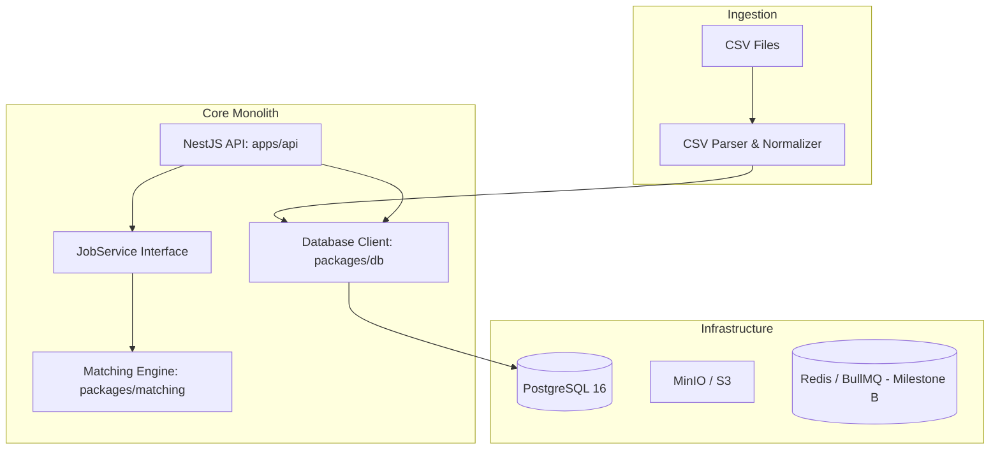

# ReconcileX Architecture

## Overview

ReconcileX is a multi-tenant financial transaction reconciliation platform designed as a modular monolith. It ingests CSV statements from independent sources (such as internal ERP orders, payment gateways, and banking records), normalizes them, detects duplicates, executes deterministic matching rules, and flags exceptions for analyst review.

## Tenancy & Isolation

- Every tenant resource is scoped by `organization_id`.
- Data isolation is enforced on every query.
- UUID primary keys are used across all tables.

## Technology Stack

- **Runtime**: Node.js v20+ / v22+
- **Backend Framework**: NestJS (modular monolith)
- **Database**: PostgreSQL 16
- **Data Access**: Drizzle ORM
- **Logging**: Pino structured logging with sensitive data redaction
- **Testing**: Vitest with SWC
- **API Documentation**: OpenAPI / Swagger
